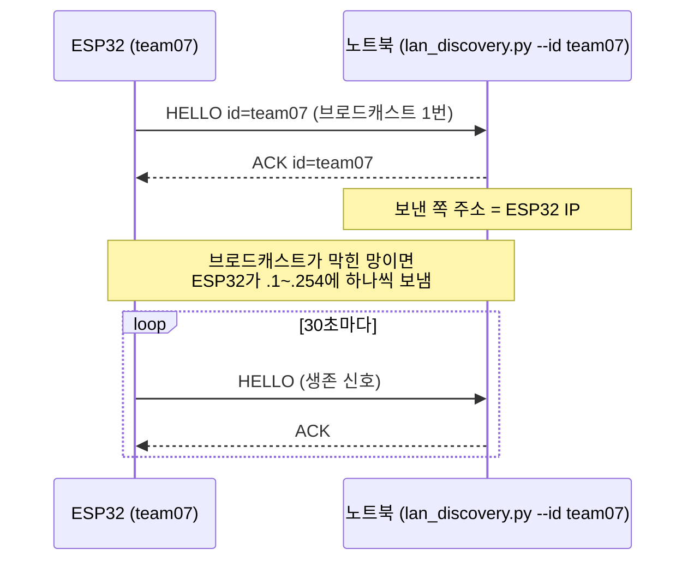

# lan-discovery: ESP32 IP 자동 찾기

ESP32의 IP를 몰라도 노트북이 **팀 ID만으로** 보드를 찾습니다.
고정 IP 설정도 공유기 관리 화면 확인도 필요 없습니다. 재부팅해서 IP가 바뀌어도 자동으로 다시 찾습니다.



## AI로 적용하기

```text
https://github.com/MJ-Park/esp32-recipes 의 lan-discovery 레시피를 내 스케치에 적용해줘. 팀 ID는 team07.
```

## 직접 적용하기

**1. 파일 2개 복사**: `src/LanDiscovery.h`, `src/LanDiscovery.cpp`를 내 스케치 폴더(.ino 옆)에 넣습니다.

**2. 코드 3줄 추가**
```cpp
#include "LanDiscovery.h"
LanDiscovery disc("team07");        // 맨 위

disc.begin();                        // setup()에서 Wi-Fi 연결 뒤
```
Wi-Fi 코드가 아직 없다면 [examples/Basic/Basic.ino](examples/Basic/Basic.ino)를 그대로 쓰세요.

**3. 노트북에서 실행** ([host/lan_discovery.py](host/lan_discovery.py) 한 파일만 있으면 됩니다)
```bash
python3 lan_discovery.py --id team07
```
```text
192.168.0.42
  found in 0.4s  team07   192.168.0.42   -59dBm  AA:BB:CC:DD:EE:FF  lib=1.0.0 http=80
```

## 노트북 쪽 명령

| 명령 | 하는 일 |
|---|---|
| `python3 lan_discovery.py --id team07` | team07을 찾으면 IP를 출력하고 종료 (스크립트에서 쓰기 좋음) |
| `python3 lan_discovery.py --id team07 --watch` | 계속 켜 두고 IP가 바뀔 때마다 출력 |
| `python3 lan_discovery.py` | 같은 망에 있는 모든 보드 목록 (응답은 보내지 않음) |
| `--json` | JSON 형식으로 출력 |

파이썬 코드에서 직접 쓸 수도 있습니다:
```python
from lan_discovery import find
ip = find("team07", timeout=15).ip
```

## ESP32 쪽에서 쓸 수 있는 것

| 코드 | 설명 |
|---|---|
| `disc.addField("http", 80)` | 노트북에 함께 알릴 정보 (`begin()` 전에 호출) |
| `disc.hasHost()` / `disc.hostIP()` | 나를 찾은 노트북의 IP. 센서 데이터를 노트북으로 보낼 때 쓰면 편합니다. |
| `disc.onHost(함수)` | 노트북을 찾았을 때 호출됨 |
| `disc.setLog(false)` | 시리얼 로그 끄기 |

## 동작 방식 (자세히)

1. Wi-Fi에 연결되면 **브로드캐스트**를 보냅니다. 패킷 하나가 같은 망 전체에 닿습니다.
2. 1.4초 안에 응답이 없으면, 자기 /24 대역 **.1~.254에 하나씩** 보냅니다. 8 ms 간격으로 보내서 전체가 약 2초 걸립니다.
3. 그래도 응답이 없으면 대기 시간을 10초, 20초, 40초, 60초로 늘려 가며 다시 시도합니다. 하나씩 보내기는 처음 두 번 이후 **5분에 한 번**만 합니다. 수십 팀이 같은 Wi-Fi를 써도 망이 붐비지 않게 하기 위해서입니다.
4. 노트북 프로그램은 켜질 때 `WHO`를 브로드캐스트합니다. 그래서 보드가 대기 중이어도 **즉시** 응답합니다.
5. 짝을 찾은 뒤에는 30초마다 생존 신호를 주고받고, 3번 연속 응답이 없으면 처음부터 다시 찾습니다.
6. **팀 ID가 같은 노트북만 응답(ACK)합니다.** 다른 팀의 노트북과 짝이 지어지지 않습니다.

메시지 형식은 [PROTOCOL.md](PROTOCOL.md)에 있습니다. 다른 언어로 옮길 때 참고하세요.

## 실측 결과

AI Thinker ESP32-CAM, Arduino-ESP32 3.3.12, macOS, 공유기 2.4 GHz 환경에서 측정했습니다.

| 상황 | 찾는 데 걸린 시간 |
|---|---|
| 일반 (브로드캐스트) | 0.4초 |
| 브로드캐스트 차단을 가정 (하나씩 보내기만 사용) | 부팅부터 5.9초 (Wi-Fi 연결 시간 포함) |
| 다른 팀 ID로 찾기 | 찾지 못함 (의도한 동작) |

## 한계

- 행사장 Wi-Fi의 **클라이언트 격리**가 켜져 있으면 기기끼리 통신 자체가 막혀서 동작하지 않습니다. 휴대폰 핫스팟을 쓰세요.
- 하나씩 보내기는 보드가 속한 /24 대역(예: 192.168.0.1~254)만 확인합니다. 브로드캐스트는 망 크기와 상관없이 닿습니다.
- 인증 기능이 없습니다. 같은 망의 누구나 메시지를 볼 수 있으니 실습용 내부망을 전제로 씁니다.
